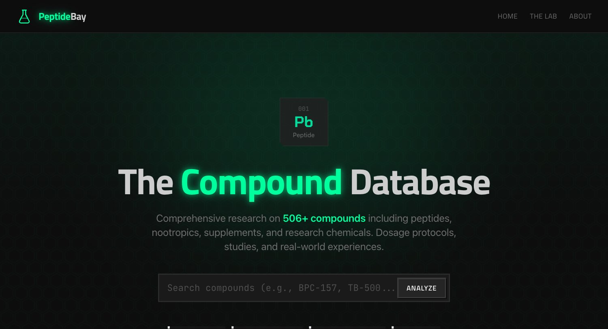
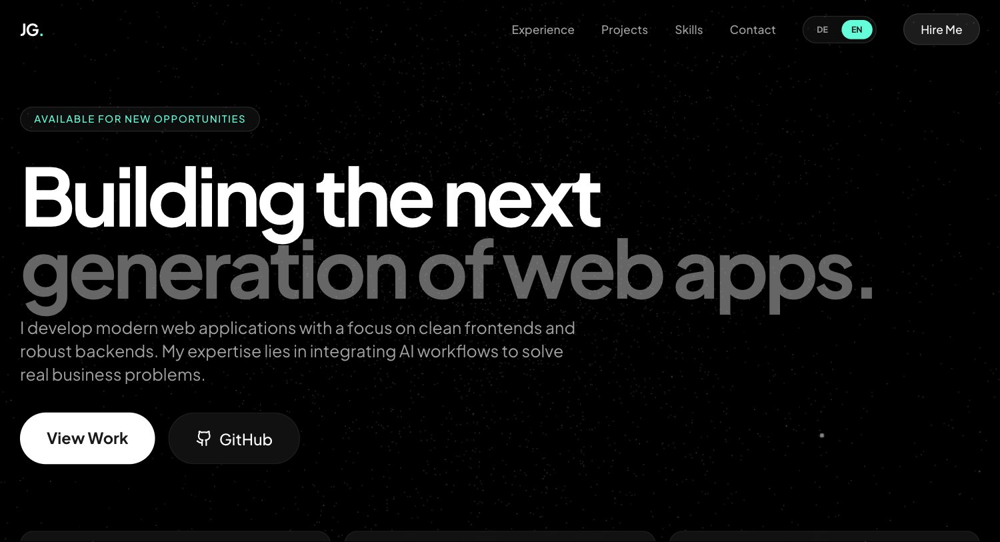

<h1 align="center">Joris Geis</h1>

  <strong>Business Informatics student · Full-stack web development</strong> 
  Oldenburg, Germany

  <a href="https://jorisgeis.de">Portfolio</a> &nbsp;·&nbsp;
  <a href="mailto:geis.joris@gmail.com">Email</a> &nbsp;·&nbsp;
  <a href="https://github.com/jorisgeis?tab=repositories">Repositories</a>

> **Looking for software engineering internships in the United States.**

## About

I'm studying **Business Informatics (B.Sc.) at Hochschule Emden/Leer**, a German university of applied sciences. Before starting my degree, I worked on full-stack product development at Groupera and frontend development at buildnext.

My work so far includes web interfaces, a gamified attendance system, and a searchable static database. Below are two projects you can explore live and in source.

## Selected work

<table>
  <tr>
    <td width="50%" valign="top">
      
      <h3>PeptideBay</h3>
      
A searchable research compound database with 506 indexed entries, category filters, and statically generated detail pages.

      
<code>Astro</code> <code>TypeScript</code> <code>Tailwind CSS</code>

      
<a href="https://jorisgeis.github.io/peptidebay/">Live site ↗</a> &nbsp;·&nbsp; <a href="https://github.com/jorisgeis/peptidebay">Source</a>

    </td>
    <td width="50%" valign="top">
      
      <h3>Personal portfolio</h3>
      
A bilingual German/English portfolio presenting my experience and projects, with responsive layouts and animated visuals.

      
<code>React</code> <code>TypeScript</code> <code>Tailwind CSS</code>

      
<a href="https://jorisgeis.de">Live site ↗</a> &nbsp;·&nbsp; <a href="https://github.com/jorisgeis/portfolio">Source</a>

    </td>
  </tr>
</table>

## Experience

**Groupera · Full-stack Developer Intern**  
November 2024 – November 2025

Built a gamified streak system for weekly group-call attendance, including freeze-token logic, progression, and UI animations. Worked with Next.js, TypeScript, Node.js, and MongoDB.

**buildnext GmbH · Junior Web Developer**  
January 2023 – October 2023

Developed responsive frontends with React and Tailwind CSS.

## Toolkit

**Frontend** &nbsp; `TypeScript` `JavaScript` `React` `Next.js` `Astro` `Tailwind CSS`  
**Backend & workflow** &nbsp; `Node.js` `MongoDB` `REST APIs` `Git`
